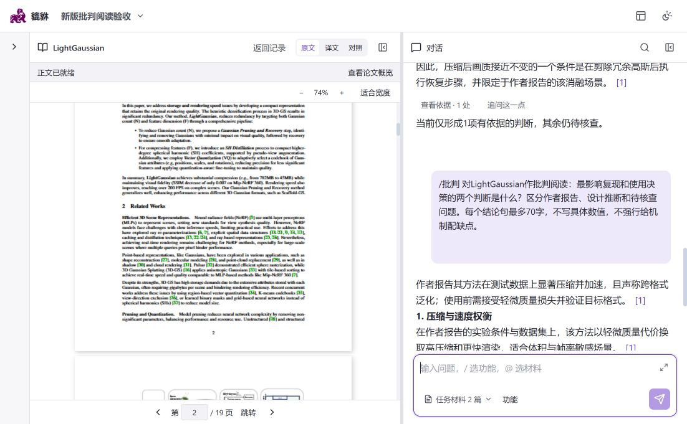
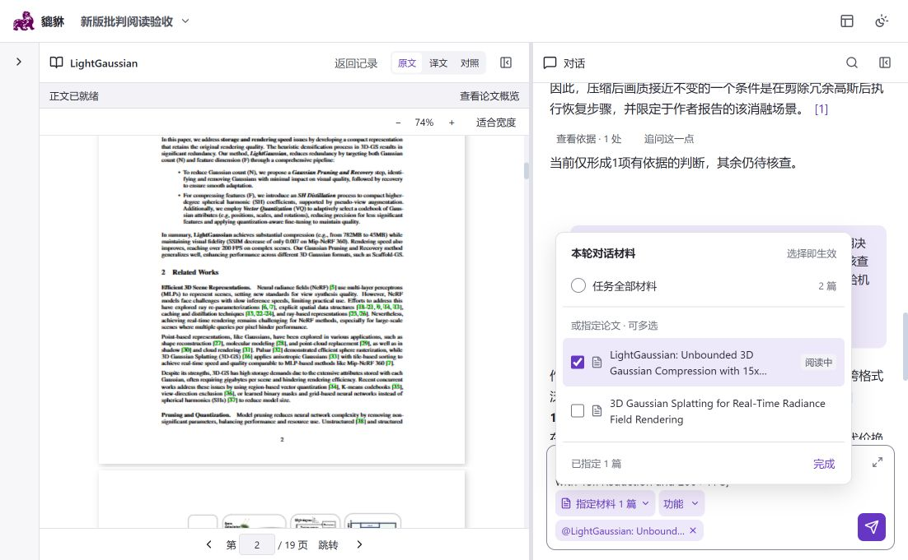
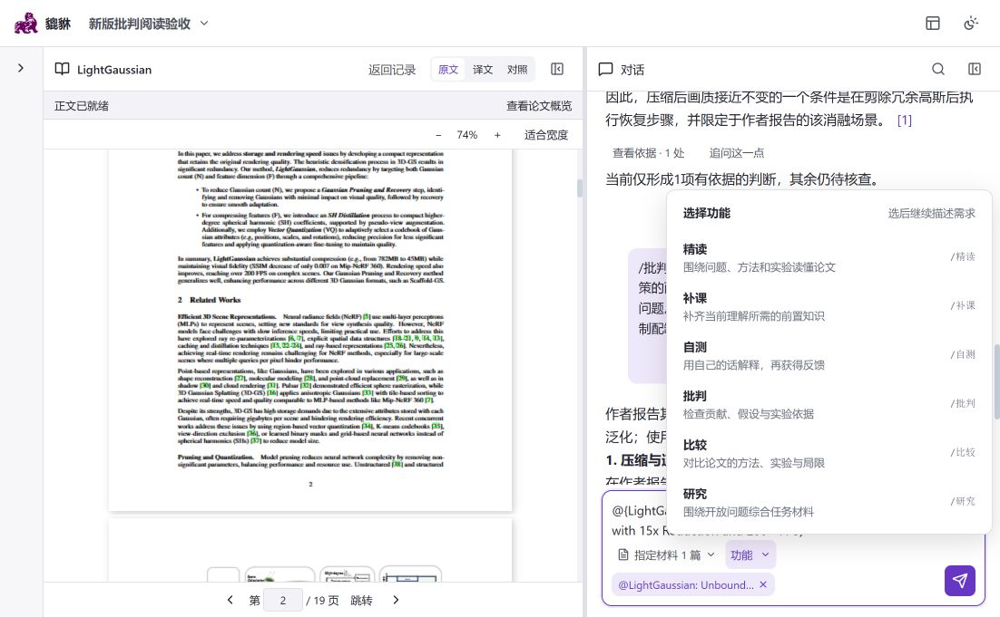

# 输入区与请求状态交互验收

日期：2026-10-11。仅验证前端交互，未提交真实模型请求。

- 输入区右上角可展开全屏编辑，共用草稿、功能与材料选择。全屏 Enter 换行，Ctrl / Cmd + Enter 发送；Esc 收起并返回按钮焦点。发送失败保留可编辑草稿和错误提示。
- 普通输入区两行起步，自动增高并设上限。在 1102×681 窗口中空输入区整体高 100px；任务材料与 @ 材料合并为一个选择入口，键入 @ 仍可使用。
- 当前论文信息收进材料弹层。选中材料后不重复添加引用，长标题标签省略显示并保留完整标题。
- 请求处理中突出状态和停止操作；查询状态放入更多操作，状态未知时保留直接查询。底部只提供“返回当前请求”，不重复展示处理状态。

验证：59 个 Vitest 文件、392 项测试及 19 组 Node 检查通过；类型检查、相关 JSX 静态检查及生产构建通过，保留已有大包体提示。

浏览器验证：1102×681 普通输入区、1280×600 全屏输入、390×640 窄屏。已检查草稿往返、全屏换行、原生模态焦点约束、Esc 关闭材料弹层后再收起编辑、功能菜单位置和窗口缩窄时模态框持续可见。验收后恢复原窗口和空草稿。

## 材料与功能选择器修订

- 材料弹层增加“本轮对话材料”标题、默认全部范围、可多选论文列表和实时数量。阅读中的论文独立标记，不等同于本轮指定材料；长标题最多显示两行，悬停查看完整标题。
- 勾选即时生效，可连续选择多篇；“完成”仅收起弹层并回到输入，点击外部收起也保留选择。取消最后一个指定项后恢复默认全部范围，问题正文保留。
- 功能按钮改用同一个弹层组件：点击外部、Esc 和切换菜单均可关闭。选择功能仅填入命令并返回编辑，不提交请求。键入 `/`、`@` 的候选列表同样支持外部与 Esc 关闭。
- 共享弹层在下方空间不足时向上展开，草稿或选择变化后重新对齐，避免遮挡底部菜单按钮。

浏览器已检查多选、菜单切换、外部关闭、Esc 焦点恢复及全屏内先关闭材料弹层再退出编辑。未发送模型请求，测试后恢复空草稿。

修订后验证：59 个 Vitest 文件、396 项测试及 19 组 Node 检查通过；类型检查、共享弹层静态检查和生产构建通过。

## 用户消息操作区

用户消息的复制、更多和保存按钮移到气泡外下方，保持右对齐。悬停范围覆盖消息及操作区，键盘聚焦时同样显示；操作行占位保留，避免显隐导致正文跳动。触屏保留常显规则。

验证：相关 3 个文件的 82 项现有测试、类型检查及生产构建通过。本次未完成浏览器视觉验收：服务原先未运行，恢复前端后，浏览器安全策略拒绝访问已有错误页，未尝试绕过访问限制。
